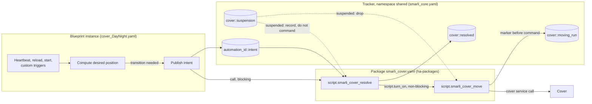
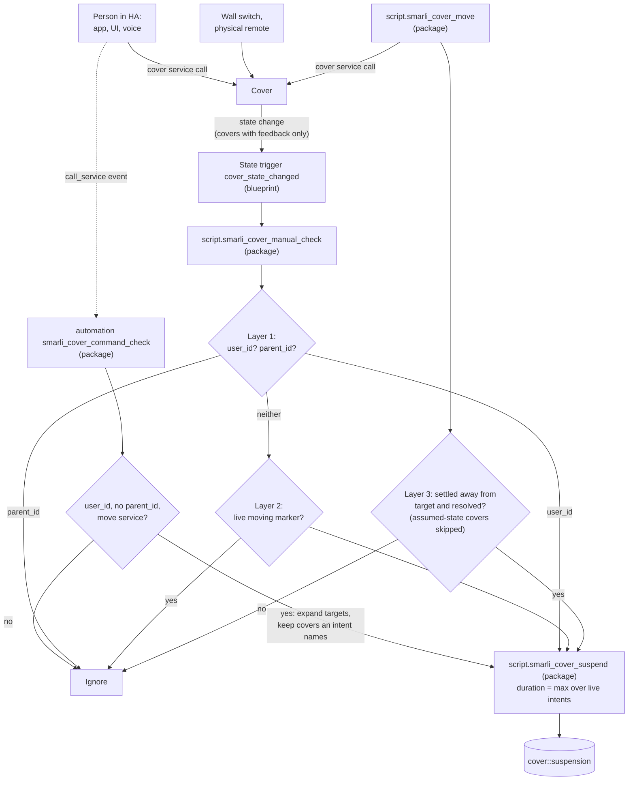

# Cover Blueprint Architecture

This is the architecture reference for the cover automation family: `cover_DayNight.yaml` today, a `shade` family planned. Read it before touching cover logic or `packages/smarli_cover.yaml` (in the separate [`smarli-AG/ha-packages`](https://github.com/smarli-AG/ha-packages) repo, not this one).

It assumes the cross-family conventions in the root `CLAUDE.md` — the tracker sensor, the package delivery-split principle, and the heartbeat-evaluator design pattern — and covers only what's specific to covers.

## Overview

For non-technical readers (onboarding, partners), [diagrams/cover-architecture.svg](diagrams/cover-architecture.svg) shows the same system as a picture, with everyday scenarios. Keep it in step with this doc when the flows below change.

Two flows share the tracker. The details follow in the sections below.

**Commanding a cover.** The blueprint only decides _what_ it wants. The package decides _whether and how_ a cover moves.



**Detecting a manual move.** Three signals lead to one place, `smarli_cover_suspend`. Only the state trigger lives in the blueprint, because a state trigger must name its entities.



A physical remote on a cover without feedback (Somfy RTS) produces neither a state change nor an event. It is not detected.

## Manual-intervention detection (shared contract)

Every cover blueprint must detect manual operation (wall switch, UI, mid-move stop) to set suspensions. Three layers:

**Layer 1 — `context` (certain cases).** On a cover state change, inspect `trigger.to_state.context`:

- `user_id` set → human via UI/app → **manual, suspend**.
- `parent_id` set → some automation/script commanded it → **not manual, ignore**.
- Neither → ambiguous: wall switch **or** an integration reporting a commanded move asynchronously with a fresh context (Zigbee/RF/KNX do this) → layer 2.

Layer 1 has a **second entry point that needs no state change**: the package automation `smarli_cover_command_check` listens to the `call_service` event for `domain: cover`. The event fires for every cover command, before the cover moves, and carries the caller's context. Same rule: `user_id` set and no `parent_id`, and the service moves the cover (`open_cover`, `close_cover`, `stop_cover`, `toggle`, `set_cover_position` — tilt is not a move). It resolves the target (entity, list, group, device, area, floor, label, `all`) to member covers, keeps those an intent names, and calls `smarli_cover_suspend` for each. This catches HA-side moves on covers without feedback and position-only changes (40 % → 60 %). It is central, not per blueprint, because the event is not entity-scoped: in the blueprint, every instance would fire on every cover command in the house. For covers with feedback, one press can suspend twice (here and via the state trigger); the second write sets nearly the same expiry.

### Who counts as a person

Both layer-1 entry points use one rule: **`user_id` set and no `parent_id` → a person → suspend.** HA sets the context, not us, so the result depends on _how_ a command reaches HA. Verified on mssw (HA 2026.5, 2026-10-28) unless marked otherwise:

| Command comes from | Context of the cover command | Result |
| --- | --- | --- |
| A person in the app, UI, dashboard | `user_id` = that person | suspend |
| A scene or script a person starts | Scripts and scenes run **in the caller's context**: on mssw, `smarli_cover_resolve` and `smarli_cover_move` carry the same context ID as the automation that started them | suspend — intended |
| An automation — even one a person triggered (dashboard button, `input_boolean`, smarli. relay) | Every automation run gets a **new** context: `parent_id` = the triggering event, `user_id` = none | ignore |
| A script or scene an automation starts | Inherits the automation's context | ignore |
| Any API caller with a long-lived token (Node-RED, external tools, the community Matter Hub add-on) | `user_id` = the user who owns the token | suspend — **counts as a person** |
| An integration with its own system user (on mssw: **Presence Simulation**) | `user_id` = that system user | suspend — **false positive** if it moves covers |
| Voice via Assist | `user_id` = the speaking user | suspend |
| Alexa / Google via Home Assistant Cloud | `user_id` = the system user "Home Assistant Cloud" (from HA's code, not tested) | suspend |
| HomeKit Bridge (HA exposed to Apple Home) | New context without `user_id` (from HA's code, not tested) | **not detected** |
| Physical remote or wall switch on a cover without feedback (Somfy RTS) | No command in HA at all | **not detected** |

Consequence of the scene/automation split: the same visible action can behave differently. A dashboard button that runs a **script** suspends the covers; a button that triggers an **automation** does not.

**API callers and system users.** A `user_id` is an HA user ID (Settings → People → Users with advanced mode, or WebSocket `config/auth/list`). A long-lived token always acts as the user who created it, so its commands cannot be told apart from that person's own app use. To exempt an API caller, give it a **dedicated HA user** and exclude that user ID. A blanket "ignore system users" rule is wrong: system users also carry real voice commands (Home Assistant Cloud). No exclusion list is built yet. On 2026-10-28 no smarli. service sent cover commands through the API.

**HomeKit Bridge** could be detected cheaply: for every command it fires a `homekit_state_change` event (with `entity_id` and `service`) in the same context as the service call. A second trigger on that event would cover it. Not built yet; mssw does not use HomeKit Bridge. (mssw has `homekit_controller`, which is the other direction: HA controlling a tado bridge.)

**Layer 2 — per-cover moving markers (disambiguate the window).** Before commanding a cover, `smarli_cover_move` writes one marker **per cover, per run** — key `<cover>::moving_<run>`, the run token living in the key so concurrent runs never collide and there is nothing to race:

```yaml
namespace: shared # MUST be shared: cover X may belong to several cover blueprints;
key: <cover_entity_id>::moving_<run> # keyed by cover AND run — not one marker per instance
value:
  target: 100 # NUMBER, always — this repo never uses 'open'/'closed' strings for targets
  until: <now + settle_timeout + 15s> # crash backstop; blind window really ends at settle (layer 3)
  started_ts: <now> # orders competing markers on the same cover when a newer run supersedes this one
```

Handler rule for ambiguous changes on cover C: **any** unexpired `<C>::moving_*` marker → a smarli. automation is moving C → ignore. None → wall switch → suspend C (duration resolved centrally — see `script.smarli_cover_suspend`, below).

**Layer 3 — per-cover settle loop (catches mid-move intervention).** After commanding, `smarli_cover_move` polls (~2 s) and classifies each cover still listed in its own run's marker: still `opening`/`closing` → leave it (exempt while genuinely moving); a newer run's marker for the same cover has since appeared (`superseded`) → drop it, **do not suspend** — another smarli. run is now driving it, that is not an intervention; stopped at its own target **or** at the current `<cover>::resolved` (the system may have moved on to a different target mid-flight) → **drop it from the marker** (finished cleanly, or correctly overtaken); stopped anywhere else → **drop it and suspend it** (mid-move intervention). The marker is removed per cover as each settles — not held until the slowest sibling finishes. The loop is bounded by `settle_timeout` (a backstop for stuck covers, sized above the slowest cover's travel); if it fires with covers still moving, the marker is left to expire via its refreshed `until` rather than false-suspending them. (This is "Option B" — chosen over a single whole-marker settle wait because the release is per-cover, which matters for instances mixing fast and slow covers; implemented once in the shared script so every cover blueprint inherits it.)

**Assumed-state covers skip layer 3.** A cover with `assumed_state: true` (one-way radio such as Somfy RTS via Overkiz) shows HA's guess, not its real state — observed in the field stuck at `opening` for days, through opens and closes. `smarli_cover_move` still writes its marker (layer 2), but leaves it out of the settle loop (`audited_covers`): auditing it would either poll until `settle_timeout` for nothing or false-suspend it on a wrong `open`/`closed`. The marker expires via `until`. For these covers, the state-based path (layers 1 and 2) also sees nothing — no state change happens. Only the command entry point of layer 1 (`smarli_cover_command_check`) detects a manual move, and only one sent through HA.

Known residual blind spot (accepted): a manual move _during_ our movement _in the same direction to the same end position_ is indistinguishable — and irrelevant, since the outcome equals the automation's intent. Sure-fire press detection exists only at device level (KNX telegrams, button events) — expose via optional custom triggers, not core mechanism.

**Suspension semantics (UX decision) — cancel, not pause:** when a suspension expires, the cover **stays in its manual position until the next scheduled transition** — the automation never "catches up" or re-asserts state on expiry. A suspension only matters if it spans a transition, and a transition falling inside one is **cancelled, not deferred**. Confirmed 2026-07-24 for every cover family (day-night today, shade when it is built).

_Flipping to "pause" (deferred catch-up) later — Phase 2 resolver:_ two edits. (1) The resolver stops writing `<cover>::resolved` for covers it skipped as suspended, so the missed transition stays pending. (2) The blueprint that wants catch-up ORs a `catchup_needed` clause into its heartbeat condition (_any of my covers not at my target and no longer suspended_), mirroring the existing weather-block retry. Safe for **targets** — a one-shot event applied late cannot loop, because the record updates once it lands. Never do it for **bounds**: a standing condition re-applied after every manual override is an endless user-vs-automation fight. The flip stays a one-liner only while all families agree; if one wants pause and another cancel, the resolver must record `<cover>::applied` (what was actually commanded) next to `<cover>::resolved` (what the system wants) and each family compares against its own.

_Forcing a re-command past the sticky `resolved` match (discussed 2026-08-03, not built):_ the resolver's `batch` filter (`smarli_cover.yaml`, "Suspended covers are recorded but NOT commanded" comment) intentionally skips a cover whose `<cover>::resolved` already equals the freshly computed target — that's what stops an unchanged republish from spuriously re-commanding a cover someone has since moved back by hand. If a call site ever needs "do it again even though nothing changed" — e.g. a technician forcing the custom open/close triggers rather than waiting on the scheduled heartbeat — add an optional `force: true` field to `script.smarli_cover_resolve`. A forced cover skips only the `changed`-vs-`resolved` check, **not** the suspension filter: an active suspension still wins, so a genuine manual override in progress is never steamrolled by a forced call. Wire `force: true` only from the blueprint's `custom_open`/`custom_close` trigger branches, never from the regular heartbeat path — otherwise every scheduled tick would start re-commanding covers a person deliberately holds elsewhere.

Keep that separate from a hypothetical **`override_suspension: true`** — a second, independent field that would _also_ cancel a live suspension. The two must never be merged into one "force level": `force` only overrides the resolver's own bookkeeping (nothing a human did gets countermanded), while `override_suspension` overrides something a _person_ just physically did — a materially bigger deal, and one no current call site asks for. Keeping them as separate opt-ins means a caller that only wants `force` can never accidentally get suspension-overriding behavior too.

## Cover arbitration: contributors publish, one resolver commands

Several cover automations can control one cover. They never command it themselves — they publish an intent and call `script.smarli_cover_resolve`, which is the single mover.

- **TARGET** = "move to position X now" — a one-shot **event**. The newest target wins; `priority` only breaks a same-tick tie.
- **BOUND** = "while I say so, stay within min…max" — a standing **condition** that clamps whatever target is current. Bounds intersect; if two cannot both hold, the higher-priority one wins outright and the other is dropped for that cover.
- `resolved = clamp(newest_target, bounds)`. With no target at all, the implicit target is the cover's own `current_position` (or the state-mapped open/closed seed for position-less covers), falling back to the stale `<cover>::resolved` only if the cover cannot report where it is at all — a bound is a statement about physical reality, so it must seed from where the cover actually sits, never from a stale memory of past intent (see `docs/superpowers/specs/2026-07-24-cover-constraint-resolver-design.md` §4 for why that distinction matters).
- An intent counts only while its owner automation **exists and is on**. Priorities: day-night 10, shade 50, safety/storm 90.

**Contributor rules.** Publish only on change (edge-based — an idle house writes nothing). Publish a **target** only when genuinely deciding "move now", inside your own operating window; withdrawing a constraint outside that window means dropping the bound **silently**, with no target — otherwise a shade family whose condition clears at 22:00 reopens covers that day-night closed at 21:00. Anything that must _hold_ against later events is a bound, not a target. Keep owning your own manual detection (scripts cannot see `trigger`).

Cover keys follow the general `<owner>::<name>` tracker key grammar (see root `CLAUDE.md`):

```text
shared:  <automation_id>::intent   <cover>::resolved   <cover>::suspension   <cover>::moving_<run>
cover_day_night:  <automation_id>::bright_since | ::dark_since
```

**Suspension duration is cover-level, not automation-level.** Several automations watch one cover and all fire on the same wall-switch press, so `script.smarli_cover_suspend` takes the **maximum** `suspension_duration` across active intents naming that cover (falling back to the caller's value only while no intent names it yet); an automation with suspension turned off contributes 0.

## Cover-family package: `packages/smarli_cover.yaml` (repo `ha-packages`)

- `script.smarli_cover_manual_check` — detection layers 1+2. Called from each blueprint's `cover_state_changed` branch, which forwards `trigger.entity_id` and context fields (scripts cannot see `trigger`).
- `automation smarli_cover_command_check` — layer 1 on the `call_service` event (see above). The package's only automation; it needs nothing from the blueprints beyond their published intents.
- `script.smarli_cover_suspend` — resolves suspension duration centrally (see above). Called by `manual_check` (layers 1–2), `smarli_cover_command_check` (layer 1, commands) and `smarli_cover_move`'s settle audit (layer 3), so every writer agrees on how long a suspension lasts.
- `script.smarli_cover_resolve` — the single mover: reads every contributor's published intent, computes `clamp(newest target, bounds)` per cover, and fires `smarli_cover_move` for whatever changed. Blueprints publish an intent and call this — they never touch markers, `<cover>::resolved`, or suspensions directly, and `smarli_cover_move` is normally its only caller.
- `script.smarli_cover_move` — the whole moving contract: filter suspended covers → per-cover marker (keyed by `run`, not by instance) → command → settle-wait → position audit (layer 3) → suspend on mismatch → remove marker.

**Cover targets are always numeric positions 0–100 — never `'open'`/`'closed'`.** There is no "just open it" in this system: every target a contributor publishes into its intent (and every value stored in the moving marker) is an explicit position — `100` = open, `0` = closed, anything between = partial. The move script translates the number per cover: `SET_POSITION`-capable covers (`supported_features` bit `4`) get `set_cover_position`; binary covers open if the target ≥ `binary_threshold` (default 50), else close. This keeps one code path for all cover hardware. **Future cover blueprints MUST pass numbers and rely on this fallback — do not reintroduce string-based open/close handling.** (Consequence: transition detection compares the numeric target, so a published intent's `targets` must store the position value, never a coarse label — a string vocabulary can't distinguish 40 from 70.)

## `cover_DayNight.yaml`: applying the heartbeat-evaluator pattern

This implements the general heartbeat-evaluator pattern (see root `CLAUDE.md`) for the day-night cycle specifically:

- **Triggers**, beyond the shared heartbeat/reload/boot set: a state trigger on the covers for manual detection (use `not_from`/`not_to: [unavailable, unknown]` — this fires on real state transitions only, suppresses per-tick attribute noise, and skips availability flaps; a bare state trigger with no `from`/`to` fires on every attribute change, and `to: null` is not valid).
- **Resolved variables computed every heartbeat:** `schedule_wants_open`/`schedule_wants_closed` per method, clamped with earliest/latest windows (window arithmetic instead of delayed actions — restart-safe), then `desired_position` (a numeric target; closed wins over open in the evening overlap; outside both phases → hold last commanded). Act only on **transitions**: `desired_position != last_commanded`, where `last_commanded` reads back this instance's own published intent (`shared.<instance_id>::intent`, `targets.values() | list`, first entry — day-night gives every one of its covers the same target, so any entry represents the instance; absent → `-1`), published _before_ calling `script.smarli_cover_resolve` so queued runs dedupe.
- **The published intent is intent, not physical state.** `shared.<instance_id>::intent` records the last position this instance _committed to requesting_ (a blocked close never publishes), never a cover's actual position. On first run no intent exists yet and `last_commanded` reads as a `-1` sentinel, which never equals a real position — so the first evaluation always transitions and drives covers to the correct phase rather than assuming their current state. Comparing intent-to-intent is what lets a manually repositioned cover keep its position (its published target still matches `desired_position`) while a transition missed during downtime is caught up on reboot (the published intent is stale). Never compare against `current_position` here — that would re-assert the target and fight manual overrides.
- **Gate the heartbeat in `conditions:`** (`trigger.id != 'heartbeat' or transition_needed or stabilizer_dirty`) — condition-failed runs don't spam logbook/traces.
- **Brightness stabilizer via tracker keys** (`<id>_lux_above_since`/`_below_since`) instead of trigger `for:` — writes only on threshold edges.
- **Weather blocks closing only**, checked at close time (current conditions + first hourly forecast entry via `weather.get_forecasts`). A blocked close does **not** publish an intent, so it retries every minute and closes as soon as weather clears.
- **Today's sun times:** `next_rising/next_setting`, minus 86400 s when they already point to tomorrow (±2 min accuracy — fine for covers).
- **The move is fired non-blocking** via `script.turn_on` (with `data: variables:`), not a direct `action: script.smarli_cover_move` call. This is load-bearing: a direct call _blocks_ the automation run for the whole settle-wait, and under `mode: queued` our own covers' state-change events queue behind it and get classified only _after_ the move removes its marker — so a contextless cover would be misread as manual and self-suspended. Firing non-blocking keeps the marker live while those state-changes are classified. Trade-off: custom open/close actions run right after the move is _initiated_, not after covers settle.
- `mode: queued` (not `single` — state changes arriving during a run would be silently dropped; not `parallel` — overlapping heartbeats could double-command and race on the shared marker key). With the non-blocking move, runs are short, so the queue does not build up.

Known limitations (documented in the blueprint): manual detection is unreliable for cover _groups_ (state triggers can't watch members; groups are still expanded for actions via `expand()`), and position-only changes that don't change the cover state (40 % → 60 %, stays `open`) are undetectable via state triggers — unless the change was commanded through HA, which `smarli_cover_command_check` catches. Assumed-state covers (Somfy RTS) never report a real state change: moves through HA are detected via the command check, physical RTS remotes are not (that would need a 433 MHz receiver, not built).

## Decision log (cover-specific)

- **Winner-takes-all priority for covers** — shade holding 20 (partial) vs. day-night wanting 0 (night): priority picks 20, leaving the cover _more open_ than the loser wanted. Priority cannot express "blocks opening, allows closing"; the target/bound split can.
- **A shade family writing a suspension to "protect" a cover** — a suspension is non-directional, so it would also block day-night's legitimate night close.
- **Priority-ownership** (each automation checks a shared owner record, then acts itself) — cheaper than a resolver, but a yielded low-priority automation never reclaims after the winner releases without an explicit poke, and coincident commands remain possible.
- **A resolver heartbeat automation** — the one case it could repair (an orphaned bound whose contributor is gone) has no remaining target to command anyway, so it buys nothing for a per-minute run and a visible system automation.
