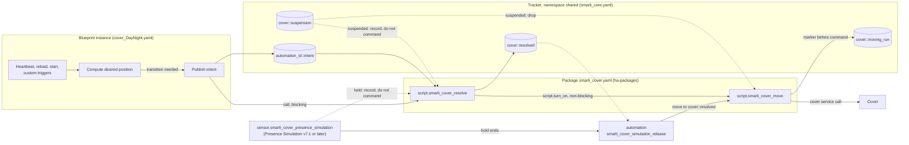
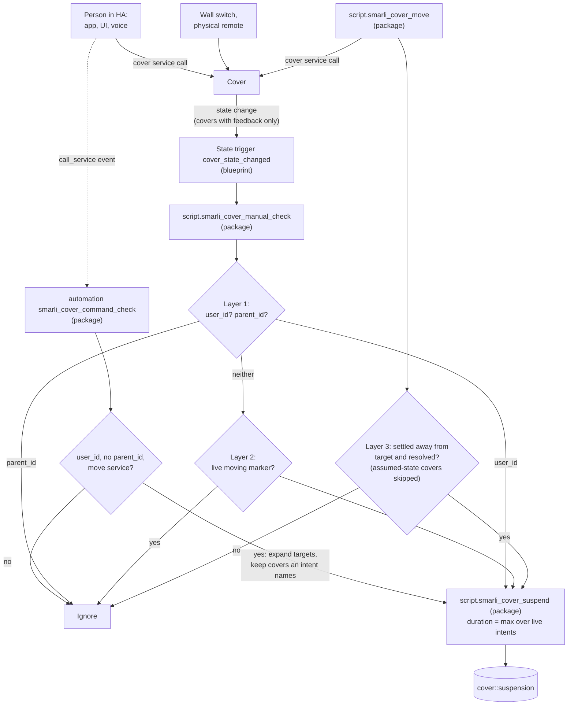

# Cover Blueprint Architecture

This is the architecture reference for the cover automation family: `cover_DayNight.yaml` today, a `shade` family planned. Read it before touching cover logic or `packages/smarli_cover.yaml` (in the separate [`smarli-AG/ha-packages`](https://github.com/smarli-AG/ha-packages) repo, not this one).

It assumes the cross-family conventions in the root `CLAUDE.md` — the tracker sensor, the package delivery-split principle, and the heartbeat-evaluator design pattern — and covers only what's specific to covers.

## Overview

For non-technical readers (onboarding, partners), [diagrams/cover-architecture.svg](diagrams/cover-architecture.svg) shows the same system as a picture, with everyday scenarios. Keep it in step with this doc when the flows below change.

Two flows share the tracker. The details follow in the sections below.

**Commanding a cover.** The blueprint only decides _what_ it wants. The package decides _whether and how_ a cover moves.



**Detecting a manual move.** Three signals lead to one place, `smarli_cover_suspend`. Only the state trigger lives in the blueprint, because a state trigger must name its entities.



A physical remote on a cover without feedback (Somfy RTS) produces neither a state change nor an event. It is not detected.

## Manual-intervention detection (shared contract)

Every cover blueprint must detect manual operation (wall switch, UI, mid-move stop) to set suspensions. Three layers:

**Layer 1 — `context` (certain cases).** On a cover state change, inspect `trigger.to_state.context`:

- `user_id` set → human via UI/app → **manual, suspend**.
- `parent_id` set → some automation/script commanded it → **not manual, ignore**.
- Neither → ambiguous: wall switch **or** an integration reporting a commanded move asynchronously with a fresh context (Zigbee/RF/KNX do this) → layer 2.

Layer 1 has a **second entry point that needs no state change**: the package automation `smarli_cover_command_check` listens to the `call_service` event for `domain: cover`. The event fires for every cover command, before the cover moves, and carries the caller's context. Same rule: `user_id` set and no `parent_id`, and the service moves the cover (`open_cover`, `close_cover`, `stop_cover`, `toggle`, `set_cover_position` — tilt is not a move). It resolves the target (entity, list, group, device, area, floor, label, `all`) to member covers, keeps those an intent names, and calls `smarli_cover_suspend` for each. This catches HA-side moves on covers without feedback and position-only changes (40 % → 60 %). It is central, not per blueprint, because the event is not entity-scoped: in the blueprint, every instance would fire on every cover command in the house. For covers with feedback, one press can suspend twice (here and via the state trigger); the second write sets nearly the same expiry.

### Who counts as a person

Both layer-1 entry points use one rule: **`user_id` set and no `parent_id` → a person → suspend.** HA sets the context, not us, so the result depends on _how_ a command reaches HA. Verified on mssw (HA 2026.5, 2026-10-28) unless marked otherwise:

| Command comes from | Context of the cover command | Result |
| --- | --- | --- |
| A person in the app, UI, dashboard | `user_id` = that person | suspend |
| A scene or script a person starts | Scripts and scenes run **in the caller's context**: on mssw, `smarli_cover_resolve` and `smarli_cover_move` carry the same context ID as the automation that started them | suspend — intended |
| An automation — even one a person triggered (dashboard button, `input_boolean`, smarli. relay) | Every automation run gets a **new** context: `parent_id` = the triggering event, `user_id` = none | ignore |
| A script or scene an automation starts | Inherits the automation's context | ignore |
| Any API caller with a long-lived token (Node-RED, external tools, the community Matter Hub add-on) | `user_id` = the user who owns the token | suspend — **counts as a person** |
| An integration with its own system user (on mssw: **Presence Simulation**) | `user_id` = that system user | suspend — accepted for Presence Simulation (decision 2026-10-28): a replayed move should win. A transition within the suspension window after a replayed move is **cancelled**, and the cover then stays where the simulation left it until the next transition — e.g. a replayed _open_ at 20:45 with a 30-min suspension cancels the 21:00 close, possibly for the whole night. Transitions outside any window still run. **From Presence Simulation v7.1 this row no longer applies to simulated covers:** they are held for the whole run, replays on them do not suspend, and they are released at the end (see "Presence Simulation" below) |
| Voice via Assist | `user_id` = the speaking user | suspend |
| Alexa / Google via Home Assistant Cloud | `user_id` = the system user "Home Assistant Cloud" (from HA's code, not tested) | suspend |
| HomeKit Bridge (HA exposed to Apple Home) | New context without `user_id` (from HA's code, not tested) | **not detected** |
| Physical remote or wall switch on a cover without feedback (Somfy RTS) | No command in HA at all | **not detected** |

Consequence of the scene/automation split: the same visible action can behave differently. A dashboard button that runs a **script** suspends the covers; a button that triggers an **automation** does not.

**A person-triggered automation cannot be recognized.** Its cover command carries only the automation's own context (`user_id` none, `parent_id` = the triggering event). HA offers no template lookup from a context ID to its user. The only workaround would cache every person's context ID from _all_ `call_service` events — heavy, and still blind to physical buttons, whose events carry no user at all. Rejected. If an action must count as manual, run it as a **script**.

**API callers and system users.** A `user_id` is an HA user ID (Settings → People → Users with advanced mode, or WebSocket `config/auth/list`). A long-lived token always acts as the user who created it, so its commands cannot be told apart from that person's own app use. To exempt an API caller, give it a **dedicated HA user** and exclude that user ID. A blanket "ignore system users" rule is wrong: system users also carry real voice commands (Home Assistant Cloud). No exclusion list is built yet. On 2026-10-28 no smarli. service sent cover commands through the API.

**HomeKit Bridge** could be detected cheaply: for every command it fires a `homekit_state_change` event (with `entity_id` and `service`) in the same context as the service call. A second trigger on that event would cover it. It must reuse the command check's target resolution (HomeKit can expose cover groups) and its tilt filter. Its own `call_service` event carries no `user_id`, so there is no double detection. **Side effect:** HomeKit does not say who sent a command, so **Apple Home automations** ("close at sunset") count as a person, the same as a tap in the Home app or Siri — they would win against day-night for the suspension window. Not built yet; mssw does not use HomeKit Bridge. (mssw has `homekit_controller`, which is the other direction: HA controlling a tado bridge.)

**Layer 2 — per-cover moving markers (disambiguate the window).** Before commanding a cover, `smarli_cover_move` writes one marker **per cover, per run** — key `<cover>::moving_<run>`, the run token living in the key so concurrent runs never collide and there is nothing to race:

```yaml
namespace: shared # MUST be shared: cover X may belong to several cover blueprints;
key: <cover_entity_id>::moving_<run> # keyed by cover AND run — not one marker per instance
value:
  target: 100 # NUMBER, always — this repo never uses 'open'/'closed' strings for targets
  until: <now + settle_timeout + 15s> # crash backstop; blind window really ends at settle (layer 3)
  started_ts: <now> # orders competing markers on the same cover when a newer run supersedes this one
```

Handler rule for ambiguous changes on cover C: **any** unexpired `<C>::moving_*` marker → a smarli. automation is moving C → ignore. None → wall switch → suspend C (duration resolved centrally — see `script.smarli_cover_suspend`, below).

**Layer 3 — per-cover settle loop (catches mid-move intervention).** After commanding, `smarli_cover_move` polls (~2 s) and classifies each cover still listed in its own run's marker: still `opening`/`closing`, or changed less than `stable_seconds` ago (see "Covers that never report opening/closing" below) → leave it (exempt while genuinely moving); a newer run's marker for the same cover has since appeared (`superseded`) → drop it, **do not suspend** — another smarli. run is now driving it, that is not an intervention; stopped at its own target **or** at the current `<cover>::resolved` (the system may have moved on to a different target mid-flight) → **drop it from the marker** (finished cleanly, or correctly overtaken); stopped anywhere else → **drop it and suspend it** (mid-move intervention). The marker is removed per cover as each settles — not held until the slowest sibling finishes. The loop is bounded by `settle_timeout` (a backstop for stuck covers, sized above the slowest cover's travel); if it fires with covers still moving, the marker is left to expire via its refreshed `until` rather than false-suspending them. (This is "Option B" — chosen over a single whole-marker settle wait because the release is per-cover, which matters for instances mixing fast and slow covers; implemented once in the shared script so every cover blueprint inherits it.)

**Assumed-state covers skip layer 3.** A cover with `assumed_state: true` (one-way radio such as Somfy RTS via Overkiz) shows HA's guess, not its real state — observed in the field stuck at `opening` for days, through opens and closes. `smarli_cover_move` still writes its marker (layer 2), but leaves it out of the settle loop (`audited_covers`): auditing it would either poll until `settle_timeout` for nothing or false-suspend it on a wrong `open`/`closed`. The marker expires via `until`. For these covers, the state-based path (layers 1 and 2) also sees nothing — no state change happens. Only the command entry point of layer 1 (`smarli_cover_command_check`) detects a manual move, and only one sent through HA.

**Covers that never report opening/closing: the quiet window (`stable_seconds`, decided 2026-10-30).** Zigbee S-ZB-COV1-R251 covers (via Z2M, no converter) report only position/tilt and a final `open`/`closed` — never `opening`/`closing`. Measured on an instance with 14 covers and 102 full moves: reports every 1.00 s (p50), worst gap 3.47 s at the start of a move, worst gap inside a move 2.31 s, the state flips to `closed` on the last position report. Venetian blinds move the tilt first for up to 8 s with the position unchanged. One cover jumps its position to the target within ~1 s and then stays silent for the ~50 s the motor runs. The loop used to judge these covers about 3 s after the command, mid-travel, and suspended them after every automated move (layer 3); and after that early release, the cover's own final `closed` report arrived with no marker, so layer 2 could read it as a wall-switch press as well.

The rule (`smarli_cover_move`, `still_moving`): a cover counts as moving while it reports `opening`/`closing`, **or** while its **position or tilt** changed less than `stable_seconds` (default **5**) ago. The loop keeps its own memory per cover (`seen`: last position/tilt, when they last changed) and compares on every 2 s pass, so a tilt-first phase counts as moving and nothing else does — not `last_updated`, which also moves on any other attribute (an integration's extra attributes could otherwise keep an idle cover "moving" until `settle_timeout`, with no audit and layer 2 masked by the live marker). A cover that has not changed at all since the command gets **2 × `stable_seconds`** to start: the loop's first look is ~5 s after the command, and without this a late first report would leave the cover judged at its start position. Only after the window does the audit run: at target or at `<cover>::resolved` (± `position_tolerance`, 5 %) → released; anywhere else → suspended. Covers that report `opening`/`closing` behave as before, plus at most `stable_seconds` at the end; assumed-state covers still skip the audit.

**End-stop rule.** A cover whose target is 0 or 100 and that reached it **exactly**, then moved away, is suspended at once (`left_end`). A cover cannot overshoot its end stop, so leaving it is a deliberate movement — typically a person tapping the wall switch to open the slats a little right after an automated close. Without the rule, 1–2 % would still count as "at target" (tolerance) while the marker keeps layer 2 out, and the same tap would be manual or not depending only on whether it came inside or after the quiet window. Mid-range targets keep the tolerance band, because a cover may overshoot and settle there (50 → 47 → 50 is not an intervention). A cover that never reports the end position exactly (stops at 1 or 99) is judged by the band as before. A run never applies the rule to a cover that a newer smarli. run took over at any point (sticky `s` in the memory): that run moved it off the end stop, and once it settles its marker is gone, so `superseded` alone would no longer show it — found in Docker when a custom close followed by a custom open suspended the cover ~14 s later. Data behind it: all 72 measured closes on the S-ZB-COV1 instance ended at 0 with the state flip on the last position report and nothing after it inside the window.

**The memory needs HA ≥ 2025.4** (since then a `variables` step inside the loop updates a variable of the outer scope instead of shadowing it). The loop checks this itself: `pass_no` must equal `repeat.index`; if it does not, `memory_ok` is false and the loop falls back to `last_updated` for the window and skips the end-stop rule, rather than reading every cover as just changed and never releasing it.

Why 5 s: the worst measured gap (3.47 s) plus one lost report (~1 s), rounded up.

How manual interventions are still caught:

| Situation | Who decides | Result |
| --- | --- | --- |
| Automated move, reports every ~1 s with gaps ≤ 3.5 s | quiet window, then audit at target | released, no suspension |
| Tilt-first blind, 8 s tilt only | tilt changes count as movement | released, no suspension |
| Overshoot at a mid target (50 → 47 → 50) | band audit after the window | released, no suspension |
| Extra attribute changing every second while idle | only position and tilt count | released after the window, not held to 180 s |
| Wall switch taps 0 → 2 % within the window after an automated close | end-stop rule | **suspended** at once (layer 3) |
| Same tap after the window | marker gone; `closed` → `open` without context | **suspended** (layer 2) — the same verdict either way |
| First report late (≤ 10 s) | start grace | released, no suspension |
| Jump-type cover: target at once, then silent travel | audit at target after 5 s | released; a later stop with the wall switch reports a position with no marker → layer 2 suspends |
| Wall switch stops the cover mid-travel | cover goes quiet → audit not at target / resolved | **suspended** (layer 3) |
| Wall switch up within 5 s after the automated close ended | marker still live, so layer 2 stays out; the new travel keeps the loop waiting; end position ≠ target | **suspended** (layer 3) |
| App / dashboard / voice | layer 1 (`user_id`), independent of the loop | **suspended** |
| Command lost, cover never moves | audit after 10 s at the start position | suspended — a false one, as before, but it also exposes a real fault |
| Person moves the cover to exactly smarli.'s target | indistinguishable | not detected — the accepted blind spot, outcome equals smarli.'s intent |

**Limits:** a small move *inside* the tolerance band at a mid target (50 → 52 by hand within the window) is not detected — the price of the band. On HA < 2025.4 (memory fallback), an extra attribute that keeps changing while idle would hold the cover until `settle_timeout` (180 s); measured S-ZB-COV1 covers carry no such attribute (only position, tilt, device class, name, features; 0 changes in 2 min idle).

Tested in Docker with `cover.silent` (`test-silent-covers.ps1`): a template cover with only position/tilt, a simulated motor with a 3.5 s start gap and 2.3 s inner gaps, tilt-first, jump-type, a 7 s first report, an overshoot at 50 %, and an icon attribute changing every second; every automated move finishes without a suspension, a stop mid-travel still suspends, and a tap away from the end stop inside the window suspends. The same test against the previous package fails the normal, tilt-first and slow-start cases. Not reproducible in Docker: contextless reports (the test cover's writes carry the script's context), so the layer-2 effect after the window rests on the R2 tests for `cover.vfast` and the reasoning above.

Known residual blind spot (accepted): a manual move _during_ our movement _in the same direction to the same end position_ is indistinguishable — and irrelevant, since the outcome equals the automation's intent. Sure-fire press detection exists only at device level (KNX telegrams, button events) — expose via optional custom triggers, not core mechanism.

**Suspension semantics (UX decision) — cancel, not pause:** when a suspension expires, the cover **stays in its manual position until the next scheduled transition** — the automation never "catches up" or re-asserts state on expiry. A suspension only matters if it spans a transition, and a transition falling inside one is **cancelled, not deferred**. Confirmed 2026-07-24 for every cover family (day-night today, shade when it is built).

_Flipping to "pause" (deferred catch-up) later — Phase 2 resolver:_ two edits. (1) The resolver stops writing `<cover>::resolved` for covers it skipped as suspended, so the missed transition stays pending. (2) The blueprint that wants catch-up ORs a `catchup_needed` clause into its heartbeat condition (_any of my covers not at my target and no longer suspended_), mirroring the existing weather-block retry. Safe for **targets** — a one-shot event applied late cannot loop, because the record updates once it lands. Never do it for **bounds**: a standing condition re-applied after every manual override is an endless user-vs-automation fight. The flip stays a one-liner only while all families agree; if one wants pause and another cancel, the resolver must record `<cover>::applied` (what was actually commanded) next to `<cover>::resolved` (what the system wants) and each family compares against its own.

_Forcing a re-command past the sticky `resolved` match (discussed 2026-08-03, not built):_ the resolver's `batch` filter (`smarli_cover.yaml`, "Suspended covers are recorded but NOT commanded" comment) intentionally skips a cover whose `<cover>::resolved` already equals the freshly computed target — that's what stops an unchanged republish from spuriously re-commanding a cover someone has since moved back by hand. If a call site ever needs "do it again even though nothing changed" — e.g. a technician forcing the custom open/close triggers rather than waiting on the scheduled heartbeat — add an optional `force: true` field to `script.smarli_cover_resolve`. A forced cover skips only the `changed`-vs-`resolved` check, **not** the suspension filter: an active suspension still wins, so a genuine manual override in progress is never steamrolled by a forced call. Wire `force: true` only from the blueprint's `custom_open`/`custom_close` trigger branches, never from the regular heartbeat path — otherwise every scheduled tick would start re-commanding covers a person deliberately holds elsewhere.

Keep that separate from a hypothetical **`override_suspension: true`** — a second, independent field that would _also_ cancel a live suspension. The two must never be merged into one "force level": `force` only overrides the resolver's own bookkeeping (nothing a human did gets countermanded), while `override_suspension` overrides something a _person_ just physically did — a materially bigger deal, and one no current call site asks for. Keeping them as separate opt-ins means a caller that only wants `force` can never accidentally get suspension-overriding behavior too.

## Cover arbitration: contributors publish, one resolver commands

Several cover automations can control one cover. They never command it themselves — they publish an intent and call `script.smarli_cover_resolve`, which is the single mover.

- **TARGET** = "move to position X now" — a one-shot **event**. The newest target wins; `priority` only breaks a same-tick tie.
- **BOUND** = "while I say so, stay within min…max" — a standing **condition** that clamps whatever target is current. Bounds intersect; if two cannot both hold, the higher-priority one wins outright and the other is dropped for that cover.
- `resolved = clamp(newest_target, bounds)`. With no target at all, the implicit target is the cover's own `current_position` (or the state-mapped open/closed seed for position-less covers), falling back to the stale `<cover>::resolved` only if the cover cannot report where it is at all — a bound is a statement about physical reality, so it must seed from where the cover actually sits, never from a stale memory of past intent (see `docs/superpowers/specs/2026-07-24-cover-constraint-resolver-design.md` §4 for why that distinction matters).
- An intent counts only while its owner automation **exists and is on**. Priorities: day-night 10, shade 50, safety/storm 90.

**Contributor rules.** Publish only on change (edge-based — an idle house writes nothing). Publish a **target** only when genuinely deciding "move now", inside your own operating window; withdrawing a constraint outside that window means dropping the bound **silently**, with no target — otherwise a shade family whose condition clears at 22:00 reopens covers that day-night closed at 21:00. Anything that must _hold_ against later events is a bound, not a target. Keep owning your own manual detection (scripts cannot see `trigger`).

Cover keys follow the general `<owner>::<name>` tracker key grammar (see root `CLAUDE.md`):

```text
shared:  <automation_id>::intent   <cover>::resolved   <cover>::suspension   <cover>::moving_<run>
cover_day_night:  <automation_id>::bright_since | ::dark_since
```

**A genuine transition is always commanded (`transition: true`).** `<cover>::resolved` is the resolver's "sticky record": an unchanged decision is never re-commanded. That rule exists for good reasons — a re-command of a cover already in place costs a full marker/command/settle cycle (a real bug once re-commanded covers on every unchanged republish), a transition cancelled by a suspension must not be executed later (_cancel, not pause_), and the accepted "removed cover keeps its old target" gap relies on it. But the record is only a memory, not where the cover is: a one-way remote on an assumed-state cover (Somfy RTS via Overkiz) or an automation outside smarli. moves the cover unseen, and the next genuine transition to the remembered position was then dropped silently (found 2026-10-29: a remote-raised shutter never closed at the scheduled time). So a caller passes `transition: true` when it publishes because its own decision changed; the resolver then also counts as changed every cover whose winning target is that caller's. Everything else stays as it was:

- Without the flag (repeat publishes, custom triggers, future callers that republish for other reasons) the sticky rule holds unchanged.
- Only covers the caller's target **wins** are forced — a cover another contributor's newer target owns, or one named only by a bound, is untouched. Coincident publishes keep the newest-`ts` winner.
- Suspended and simulation-held covers are still filtered from `batch`, so _cancel, not pause_ holds; nothing republishes when a suspension ends.
- `cover_DayNight` sets the flag only on heartbeat runs, which reach a publish only when `transition_needed` (a phase change, a missed phase after a restart, a new instance, or a schedule edit via the fingerprint) — at most a few commands a day per instance.
- A re-command to a cover already in place is harmless: HA's cover services never check the state (`cover.close_cover` always calls the integration; Overkiz always sends the command to the box), a position cover given its own position does not move and passes the settle audit, and assumed-state covers skip the audit entirely (`audited_covers`), so no false suspension.
- Version mix is safe both ways: an old blueprint never sends the flag (old behaviour), and an old resolver ignores it (each script's own service accepts any keys, `SCRIPT_SERVICE_SCHEMA = Schema(dict)`).
- **Accepted behaviour change:** when two instances control one cover, a later scheduled close now also closes a cover raised with a remote in between. That is a planned close, so it is the expected result.
- What Docker cannot show (a real RTS motor receiving "close" while closed, a real remote) is in the hardware checklist, `docs/cover-hardware-tests.md` (H1–H7).

**Suspension duration is cover-level, not automation-level.** Several automations watch one cover and all fire on the same wall-switch press, so `script.smarli_cover_suspend` takes the **maximum** `suspension_duration` across active intents naming that cover (falling back to the caller's value only while no intent names it yet); an automation with suspension turned off contributes 0.

## Cover-family package: `packages/smarli_cover.yaml` (repo `ha-packages`)

- `script.smarli_cover_manual_check` — detection layers 1+2. Called from each blueprint's `cover_state_changed` branch, which forwards `trigger.entity_id` and context fields (scripts cannot see `trigger`).
- `automation smarli_cover_command_check` — layer 1 on the `call_service` event (see above). It needs nothing from the blueprints beyond their published intents.
- `sensor.smarli_cover_presence_simulation` and `automation smarli_cover_simulation_release` — the Presence Simulation hold and release (see "Presence Simulation" below).
- `script.smarli_cover_suspend` — resolves suspension duration centrally (see above). Called by `manual_check` (layers 1–2), `smarli_cover_command_check` (layer 1, commands) and `smarli_cover_move`'s settle audit (layer 3), so every writer agrees on how long a suspension lasts.
- `script.smarli_cover_resolve` — the single mover: reads every contributor's published intent, computes `clamp(newest target, bounds)` per cover, and fires `smarli_cover_move` for whatever changed. Blueprints publish an intent and call this — they never touch markers, `<cover>::resolved`, or suspensions directly, and `smarli_cover_move` is normally its only caller. The one exception is `smarli_cover_simulation_release`, which re-sends an unchanged decision after a Presence Simulation hold.
- `script.smarli_cover_move` — the whole moving contract: filter suspended covers → per-cover marker (keyed by `run`, not by instance) → command → settle-wait → position audit (layer 3) → suspend on mismatch → remove marker.

**Cover targets are always numeric positions 0–100 — never `'open'`/`'closed'`.** There is no "just open it" in this system: every target a contributor publishes into its intent (and every value stored in the moving marker) is an explicit position — `100` = open, `0` = closed, anything between = partial. The move script translates the number per cover: `SET_POSITION`-capable covers (`supported_features` bit `4`) get `set_cover_position`; binary covers open if the target ≥ `binary_threshold` (default 50), else close. This keeps one code path for all cover hardware. **Future cover blueprints MUST pass numbers and rely on this fallback — do not reintroduce string-based open/close handling.** (Consequence: transition detection compares the numeric target, so a published intent's `targets` must store the position value, never a coarse label — a string vocabulary can't distinguish 40 from 70.)

## `cover_DayNight.yaml`: applying the heartbeat-evaluator pattern

This implements the general heartbeat-evaluator pattern (see root `CLAUDE.md`) for the day-night cycle specifically:

- **Triggers**, beyond the shared heartbeat/reload/boot set: a state trigger on the covers for manual detection (use `not_from`/`not_to: [unavailable, unknown]` — this fires on real state transitions only, suppresses per-tick attribute noise, and skips availability flaps; a bare state trigger with no `from`/`to` fires on every attribute change, and `to: null` is not valid).
- **Resolved variables computed every heartbeat:** `schedule_wants_open`/`schedule_wants_closed` per method, clamped with earliest/latest windows (window arithmetic instead of delayed actions — restart-safe), then `desired_position` (a numeric target; closed wins over open in the evening overlap; outside both phases → hold the last scheduled decision). Act only on **transitions**: `desired_position != last_scheduled`, where `last_scheduled` reads back this instance's own published intent (`shared.<instance_id>::intent`, its `phase`; an intent from before 3.1.2 has no `phase` and falls back to the first `targets` entry — day-night gives every one of its covers the same target, so any entry represents the instance; absent → `-1`), published _before_ calling `script.smarli_cover_resolve` so queued runs dedupe.
- **`phase` and `targets` are kept apart (3.1.2) so custom triggers hold.** `phase` is what the _schedule_ last decided; `targets` is what this instance asked the resolver for. A heartbeat publishes the schedule's position in both. A custom trigger (`custom_open`/`custom_close`) publishes its own position in `targets` and keeps the schedule's last `phase` (or the schedule's current view if there is none yet), so the next heartbeat sees no change and the custom position **holds until the schedule's next phase change** — decided 2026-10-29: a custom trigger is a deliberate intervention against the schedule. Before 3.1.2 the custom branches published the schedule's own position (`desired_position`), so a custom extend during the day sent "retract" and did nothing; comparing the next heartbeat against a custom target instead would have undone it within a minute. Custom triggers obey suspensions like every other command (decided: a pause after a manual move is not overridden). Custom triggers do **not** pass the resolver's `transition` flag — a **temporary decision (2026-10-29), revisit if it becomes a problem**: a custom command to a position the resolver believes is current (e.g. after a remote move) is dropped, but a custom trigger that fires often cannot cause repeated commands.
- **The published intent is intent, not physical state.** `shared.<instance_id>::intent` records the last position this instance _committed to requesting_ (a blocked close never publishes), never a cover's actual position. On first run no intent exists yet and `last_scheduled` reads as a `-1` sentinel, which never equals a real position — so the first evaluation always transitions and drives covers to the correct phase rather than assuming their current state. Comparing intent-to-intent is what lets a manually repositioned cover keep its position (its published target still matches `desired_position`) while a transition missed during downtime is caught up on reboot (the published intent is stale). Never compare against `current_position` here — that would re-assert the target and fight manual overrides.
- **The intent carries a settings fingerprint.** `intent_payload.fingerprint` is `schedule_fingerprint`: an `md5` over a fixed list of the raw schedule inputs (method, workday trackers, every open/close time with its earliest/latest bound and `*_helper` id, sun offsets, brightness settings, the sorted cover list). `last_scheduled` reads `-1` when the stored fingerprint differs from the current one, so editing the schedule re-evaluates the covers instead of comparing the new times against the position the old settings committed to. Without it, an edit that makes a close due while the stored intent is already `0` is a silent 0 → 0 no-op — found when a test automation, saved at 16:08 after an earlier run at 16:06 had committed `0`, never closed at its 16:10 earliest-close time. Rules for the list: **raw inputs, not resolved values** (`close_time` flips daily with the workday sensor, so hashing it would mismatch every day); **helper entity ids, not helper states** (a runtime helper change is deliberate and must not reset the memory); **weather, wind and suspension settings stay out** (they never change `desired_position`). A new input that influences the phase must be added to the list. When in doubt, include it: an extra mismatch costs one harmless re-command (the resolver moves only what changed), a missing input leaves the bug. **The fingerprint is versioned** (`fp1:<md5>`). Only a stored fingerprint of the _same_ version can prove an edit; no fingerprint (published before 3.1.2) or another version counts as matching and is replaced at the instance's next transition. So a release never moves covers fleet-wide: neither the 3.1.2 update itself nor a later release that changes the list or the default of a listed input. **Bump the version (`fp2`, …) whenever the list or a listed default changes** (`ci/check-release.sh` enforces this through `ci/check-fingerprint.js`) — otherwise every instance on that default sees a mismatch at once and re-commands its covers at whatever time the update lands. The price is small: an edit made between the release and the next transition goes unnoticed, which is the pre-3.1.2 behaviour. The prefix also stops HA from re-parsing an all-digit hash as a number.
- **Gate the heartbeat in `conditions:`** (`trigger.id != 'heartbeat' or transition_needed or stabilizer_dirty`) — condition-failed runs don't spam logbook/traces.
- **Brightness stabilizer via tracker keys** (`<id>_lux_above_since`/`_below_since`) instead of trigger `for:` — writes only on threshold edges.
- **Weather blocks closing only**, checked at close time (current conditions + first hourly forecast entry via `weather.get_forecasts`). A blocked close does **not** publish an intent, so it retries every minute and closes as soon as weather clears.
- **Today's sun times:** `next_rising/next_setting`, minus 86400 s when they already point to tomorrow (±2 min accuracy — fine for covers).
- **The move is fired non-blocking** via `script.turn_on` (with `data: variables:`), not a direct `action: script.smarli_cover_move` call. This is load-bearing: a direct call _blocks_ the automation run for the whole settle-wait, and under `mode: queued` our own covers' state-change events queue behind it and get classified only _after_ the move removes its marker — so a contextless cover would be misread as manual and self-suspended. Firing non-blocking keeps the marker live while those state-changes are classified. Trade-off: custom open/close actions run right after the move is _initiated_, not after covers settle.
- `mode: queued` (not `single` — state changes arriving during a run would be silently dropped; not `parallel` — overlapping heartbeats could double-command and race on the shared marker key). With the non-blocking move, runs are short, so the queue does not build up.

Known limitations (documented in the blueprint): manual detection is unreliable for cover _groups_ (state triggers can't watch members; groups are still expanded for actions via `expand()`), and position-only changes that don't change the cover state (40 % → 60 %, stays `open`) are undetectable via state triggers — unless the change was commanded through HA, which `smarli_cover_command_check` catches. Assumed-state covers (Somfy RTS) never report a real state change: moves through HA are detected via the command check, physical RTS remotes are not (that would need a 433 MHz receiver, not built).

## Presence Simulation

**While a simulation runs, smarli. leaves its covers alone; when it stops, they return to what smarli. wants now (decision 2026-10-28).** Three parts, all in `smarli_cover.yaml`:

1. **Hold.** `sensor.smarli_cover_presence_simulation` lists the covers held: those in the `current_entities` attribute of every `presence_simulation` switch that is `on` (state = count, attribute `covers`). The resolver records these covers in `<cover>::resolved` but does not command them. So `::resolved` always holds what smarli. wants _now_ — day-night transitions during the hold included.
2. **No suspension from replays.** The simulation replays as its own system user, which no person is linked to. On a held cover, a command or state change from a user **without a person** creates no suspension (command check and `manual_check`). A person's hand move during the simulation, or a wall switch (no user, layer 2), still suspends. **The settle loop (layer 3) also stops judging a held cover** (added 2026-10-30): a move the resolver started just before the hold began is still being audited, and a replay moving the cover would otherwise read as an intervention — a suspension nobody caused, which would also block the release. The loop releases a held cover's marker at once, so layer 1 and 2 apply normally again. Tested in Docker by writing the sensor's attribute (`test-silent-covers.ps1`, `simhold`).
3. **Release.** `automation smarli_cover_simulation_release` triggers when covers leave the sensor's list (the simulation stops, or its entity list shrinks). It moves each released cover that a live intent names to its `<cover>::resolved`, through `smarli_cover_move` directly — the resolver would not command it, because its decision did not change. The move script still skips suspended covers, so a person's hand move during the simulation wins over the release.

Example: day-night closes at 21:00 while the simulation holds the cover (`::resolved` = 0). You come home at 22:30 and turn the simulation off. The cover closes at once — unless you moved it by hand during the last suspension window.

The sensor expands `current_entities` itself. After an HA restart during a running simulation, the integration rebuilds the list before groups have loaded, so the list names the group, not its member covers (seen on hi-thomas, v7.1), and it is never rebuilt during that run. `expand()` in the sensor re-renders once the group loads. The group id that briefly leaves the list is not named by any intent, so the release ignores it.

**Accepted gap: logins without a person (decision 2026-10-28).** The replay exemption cannot tell the simulation's system user from any other user that has no person — e.g. a wall tablet with its own login (on hi-thomas: `smarli_local`, `smarli_user`). While a simulation runs, such a user's move on a held cover writes no suspension, so the release at the end of the simulation overwrites it. Outside a simulation it suspends as usual. Accepted because a simulation usually means nobody is home, and only the release overwrites the move. Giving such logins a person would close the gap. Recognizing the simulation by its `last_event` attribute would too, but needs a live test first.

**Setup rule: keep the simulation's `restore_states` option off** on systems with smarli. cover automations. On stop, it restores the states from before the simulation at the same moment as the release, and the two commands race.

**Only effective from Presence Simulation v7.1. This matters when upgrading older systems.**

| Presence Simulation | Hold, release, no suspension from replays | Replayed move suspends the cover |
| --- | --- | --- |
| **v7.1 or later** | **yes** | no (held cover, user without a person) |
| v5.0 – v6.x | no — no `current_entities` (v5.3 checked; v6.x not checked) | yes (system user) |
| before v5.0 | no | only on covers with feedback (layer 2); covers without feedback (Somfy RTS): not at all |

So on an older system day-night still interferes with the simulation. Upgrade Presence Simulation to v7.1 or later when retrofitting or upgrading a system that uses it.

## Open observations (not acted on yet)

Findings worth tackling later. Each says what was seen, why it matters, and the fix considered.

- **Scenes do not always suspend the covers they move (noted 2026-10-30).** Scenes are always
  triggered by a person, so a cover a scene moves should always be suspended. The Grundinstanz
  script `script.execute_cover_actions_from_scenes` (called by every scene script) moves covers
  with `cover.set_cover_position` directly — past the resolver, so without a marker and without
  updating `<cover>::resolved`. Whether smarli. then suspends depends on how the scene started:
  - A person directly (dashboard, app, voice): the command carries their `user_id` →
    `smarli_cover_command_check` (layer 1) suspends. ✓
  - A button through a smarli. scene blueprint (automation → scene script → this script): the
    command carries a `parent_id` and no `user_id`, so layer 1 treats it as an automation. Only
    layer 2 can catch it, and layer 2 runs only on a **state** change (the blueprints' state
    trigger uses `not_from`/`not_to`, which ignores attribute-only changes). So 30 % → 0 %
    (`open` → `closed`) suspends, but 30 % → 10 % (stays `open`) does not, and a later smarli.
    transition or a shade bound can move the cover against the person's choice. ✗

  Considered fix: one step in `execute_cover_actions_from_scenes`, before `set_cover_position`,
  that calls `script.smarli_cover_suspend` for `cover_entity` (`continue_on_error: true`, so an
  instance without the smarli. packages does not fail). It covers every start path the same way
  and also covers the script's later tilt step. Open: where the Grundinstanz scripts are
  maintained — the script is in neither this repo nor `ha-packages`.

  Related: the script's tilt step (`script.cover_tilt_up` / `cover_tilt_down`, ~2 s after the
  cover reached 90 % of its move, for every `shutter`/`blind` device class) may be a source of
  the lone `closed` → `open` 0 → 1 % reports measured 9–22 s after a close on S-ZB-COV1 covers.
  Not verified: the source of the tilt scripts was not reviewed, and on the measured instance
  (no smarli. packages) the logbook showed no script runs, so the nudges there came from a wall
  switch or from Z2M directly. smarli. treats such a nudge as manual (layer 2), which is correct
  if a person caused it.

## Requirements for future cover families

**Weather protection must win over Presence Simulation (noted 2026-10-28).** A future weather-protection blueprint (hail, storm) must not let any source extend covers while protection is active — Presence Simulation included. Constraints known today:

- **Presence Simulation bypasses the resolver.** It calls `cover.*` services directly (`entity_controller.py`, `_handle_cover`), so neither priorities nor bounds can stop its commands. Protection must react _after_ such a command (re-command the cover) or keep the simulation from replaying covers while protection is active.
- **A suspension blocks every smarli. command, safety included.** Since v5.0, each replayed move suspends the cover (layer 1 sees its system user). Protection therefore needs to override live suspensions — the `override_suspension` idea in the layer-3 section above, which so far no call site needed. The same applies to the Presence Simulation **hold** in the resolver (v7.1 or later): protection must override it too.
- **Version matters.** Before v5.0 the simulation's commands carry no user; on covers without feedback (Somfy RTS) they are invisible to every layer. Protection cannot rely on detecting the replay.

## Decision log (cover-specific)

- **Winner-takes-all priority for covers** — shade holding 20 (partial) vs. day-night wanting 0 (night): priority picks 20, leaving the cover _more open_ than the loser wanted. Priority cannot express "blocks opening, allows closing"; the target/bound split can.
- **A shade family writing a suspension to "protect" a cover** — a suspension is non-directional, so it would also block day-night's legitimate night close.
- **Priority-ownership** (each automation checks a shared owner record, then acts itself) — cheaper than a resolver, but a yielded low-priority automation never reclaims after the winner releases without an explicit poke, and coincident commands remain possible.
- **Clearing the instance's intent on `automation_reloaded`** (to fix the stale-intent no-op after an edit) — that event fires on every automation reload, whether or not this automation's settings changed, and the same reset wired to Home Assistant start would re-command every cover on every restart, losing the restart-safe intent comparison. The fingerprint resets the memory only when the schedule settings really changed.
- **Forcing the command whenever a caller passes a fresh `intent`** (instead of an explicit `transition` flag) — every custom-trigger firing would re-command, and any future caller that republishes for another reason would silently lose the sticky rule. The flag keeps the contract visible at the call site.
- **Forcing only assumed-state covers** — two rules where one does; covers with real feedback are already protected by detection + suspension, so the general rule costs them nothing.
- **Clearing `<cover>::resolved` on every transition** — the bound-only path uses it as a last-resort seed, so this has the same effect with more side effects.
- **Keeping the old fingerprint lists to verify an older-version fingerprint** — every list would have to live in the blueprint forever. Accepting another version as matching costs only an edit missed until the next transition.
- **A custom trigger that publishes its target and lets the heartbeat compare against it** — the heartbeat sees "schedule says open, last sent closed" and reopens within a minute. The separate `phase` record is what lets a custom position hold.
- **Custom triggers that override a suspension** — a pause after a manual move protects the person's choice; a custom trigger is not more deliberate than the person standing at the switch.
- **A power-based "still moving" rule for silent covers** (cover counts as moving while its power sensor draws current) — power reports only about every 10 s, so the rule needs a ~70 s limit, and it adds nothing on a cover that is silent anyway. The quiet window on `last_updated` covers the measured cases without a second entity.
- **A 4 s or 6 s quiet window** — 4 s leaves no room for a lost report after the worst measured 3.47 s gap; 6 s only lengthens the masked window after every move for no measured benefit. 5 s = worst gap + one lost report.
- **A resolver heartbeat automation** — the one case it could repair (an orphaned bound whose contributor is gone) has no remaining target to command anyway, so it buys nothing for a per-minute run and a visible system automation.
